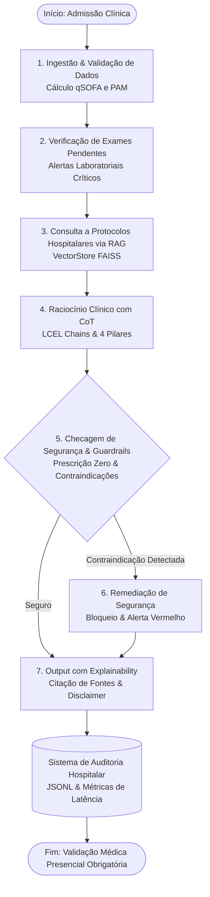

# 🏥 Hospital AI Assistant — Tech Challenge Fase 3 (FIAP)

> **Pós-Graduação em Inteligência Artificial para DEVs**  
> **Tema:** Sistema Especialista de Suporte à Decisão Clínica Hospitalar (CDSS)  
> **Stack Oficial:** Python 3.10+ | LangChain | LangGraph | FAISS | PEFT LoRA (LLaMA 3) | Transformers

---

## 📑 Sumário Executivo
1. [Visão Geral da Solução](#-visão-geral-da-solução)
2. [Arquitetura de Pastas e Módulos](#-arquitetura-de-pastas-e-módulos)
3. [Diagrama de Fluxo do LangGraph (Mermaid)](#-diagrama-de-fluxo-do-langgraph-mermaid)
4. [Engenharia de Prompt: Os 4 Pilares e Chain-of-Thought (CoT)](#-engenharia-de-prompt-os-4-pilares-e-chain-of-thought-cot)
5. [Estratégia de Fine-Tuning com LoRA (PEFT + HuggingFace TRL)](#-estratégia-de-fine-tuning-com-lora-peft--huggingface-trl)
6. [Motor RAG e Indexação Vetorial](#-motor-rag-e-indexação-vetorial)
7. [Camada de Segurança, Guardrails e Governança](#-camada-de-segurança-guardrails-e-governança)
8. [Sistema de Auditoria e Conformidade (LGPD / CFM)](#-sistema-de-auditoria-e-conformidade-lgpd--cfm)
9. [Instruções de Instalação e Execução](#-instruções-de-instalação-e-execução)

---

## 🎯 Visão Geral da Solução

O **Hospital AI Assistant** é um sistema avançado de Suporte à Decisão Clínica (CDSS - *Clinical Decision Support System*), projetado para auxiliar equipes médicas e de triagem hospitalar no reconhecimento ágil de condições clínicas tempo-dependentes (ex: **Sepse**, **Crise Hipertensiva** e **Síndrome Coronariana Aguda**).

### Princípios Bioéticos e Regulatórios
- **Zero Prescrição Autônoma:** Em estrita observância às resoluções do Conselho Federal de Medicina (CFM) e aos princípios éticos de IA em saúde, o sistema **NUNCA** emite prescrições médicas diretas. Toda orientação é expressa como recomendação preliminar condicionada à validação física e assinatura de um médico registrado (CRM).
- **Rastreabilidade e Explainability:** Nenhuma conduta é sugerida sem que haja citação explícita do protocolo clínico institucional e do grau de evidência científica correspondente.
- **Anonimização Ativa (LGPD/HIPAA):** Higienização de dados pessoais identificáveis (PII) com hashing determinístico de identificadores antes de qualquer processamento por LLMs.

---

## 📁 Arquitetura de Pastas e Módulos

O projeto adota uma arquitetura modular, desacoplada e aderente aos padrões da engenharia de software moderna:

```
hospital_ai_assistant/
│
├── dataset/
│   ├── prepare_data.py          # Pipeline de pré-processamento, anonimização LGPD e geração de pares SFT/RAG
│   ├── synthetic_protocols.json # Base estruturada de protocolos institucionais e casos clínicos sintéticos
│   ├── sft_training_data.jsonl  # Dataset instrucional formatado para fine-tuning (ChatML / LLaMA 3)
│   └── rag_knowledge_base.json  # Corpus modular com metadados para indexação vetorial
│
├── finetuning/
│   └── train_lora.py            # Script completo de Fine-Tuning com LoRA (PEFT + SFTTrainer/TRL)
│
├── rag_engine/
│   └── vectorstore.py           # Motor RAG com FAISS, chunking clínico e embeddings determinísticos
│
├── safety/
│   ├── guardrails.py            # Camada de segurança (Zero Prescrição, Contraindicações, Grounding)
│   └── audit_logger.py          # Sistema de auditoria com persistência JSONL e medição de latência
│
├── agent/
│   ├── state.py                 # Tipagem de estado clínico com TypedDict (StateGraph)
│   ├── chains.py                # LCEL Chains, templates com os 4 pilares, CoT e fallback resiliente
│   └── graph.py                 # Grafo de estados do LangGraph (nós, bifurcações condicionais e remediação)
│
├── audit_logs/                  # Diretório de persistência de auditorias (JSONL)
├── storage/                     # Checkpoints e relatórios de adaptadores LoRA
├── main.py                      # Ponto de entrada CLI interativo demonstrando casos clínicos
├── requirements.txt             # Dependências estritas do projeto
└── README.md                    # Documentação técnica e guia de execução
```

---

## 📊 Diagrama de Fluxo do LangGraph (Mermaid)

O fluxo de decisão clínica é orquestrado por uma máquina de estados finita construída sobre o `StateGraph` do **LangGraph**:



### Explicação dos Nós do Grafo:
1. `node_ingest_and_validate`: Valida tipagem, higieniza dados e calcula escores de triagem automatizados (**qSOFA** para sepse, **PAM** para hemodinâmica). Se $qSOFA \ge 2$ ou $PAS \ge 180$, classifica como caso crítico imediato.
2. `node_check_pending_exams`: Cruza os exames pendentes com os critérios de confirmação diagnóstica, alertando sobre a urgência de processamento de exames como *lactato arterial*, *hemoculturas* ou *troponina*.
3. `node_query_protocols_rag`: Formula uma consulta semântica baseada na queixa e sinais vitais, consultando o VectorStore para recuperar as diretrizes institucionais aplicáveis.
4. `node_generate_clinical_reasoning`: Executa a chain LangChain aplicando raciocínio passo a passo (**Chain-of-Thought**) sob o contexto delimitado dos protocolos.
5. `node_safety_and_guardrails`: Valida a inferência contra prescrições imperativas autônomas, averigua a presença da citação de fontes institucionais e checa contraindicações conhecidas.
6. `node_safety_remediation`: *(Nó Condicional)* Intervém caso haja conduta contraindicada, injetando alertas de bloqueio institucional antes da emissão.
7. `node_format_explainability_output`: Formata o laudo final com referências científicas completas e disclaimer médico legal obrigatório.

---

## 🧠 Engenharia de Prompt: Os 4 Pilares e Chain-of-Thought (CoT)

Os templates em `agent/chains.py` implementam rigorosamente os **4 Pilares de Engenharia de Prompt**:

| Pilar | Papel Pedagógico | Implementação no Assistente |
|---|---|---|
| **1. Instrução Clara** | Define o papel (*Persona*), escopo de atuação e proibições éticas. | Define o assistente como CDSS do hospital, proibindo prescrições autônomas sem CRM. |
| **2. Contexto Delimitado** | Restringe a geração aos documentos recuperados pelo RAG. | Protocolos hospitalares injetados entre tags `<protocolos_hospitalares>...</protocolos_hospitalares>`. |
| **3. Dados de Entrada Estruturados** | Fornece dados clínicos sem ambiguidade semântica. | JSON estruturado contendo idade, sinais vitais, histórico, exames pendentes e concluídos. |
| **4. Indicador de Formato de Saída** | Padroniza a resposta para consumo profissional. | Markdown estruturado em 5 seções obrigatórias: CoT, Alertas, Condutas, Fontes e Disclaimer. |

### Raciocínio Clínico Passo a Passo (Chain-of-Thought - CoT)
O modelo é instruído a decompor a análise antes de sugerir condutas:
1. **Passo 1:** Interpretar os sinais vitais brutos (frequência respiratória, pressão, saturação, temperatura).
2. **Passo 2:** Calcular e pontuar os escores de risco ($qSOFA$, $NEWS2$, $PAM$).
3. **Passo 3:** Identificar diagnósticos diferenciais e lesões agudas de órgãos-alvo.
4. **Passo 4:** Correlacionar os achados com os pacotes de intervenção do protocolo institucional recuperado.
5. **Passo 5:** Formatar cada recomendação com aviso expresso de validação médica física.

---

## 🧬 Estratégia de Fine-Tuning com LoRA (PEFT + HuggingFace TRL)

O script `finetuning/train_lora.py` implementa a adaptação supervisionada de modelos fundacionais (LLaMA 3 / 3.1 8B):

### Formulação Matemática do LoRA:
Em vez de ajustar a matriz densa original $W_0 \in \mathbb{R}^{d \times k}$, o LoRA congela $W_0$ e introduz matrizes de baixo posto $B \in \mathbb{R}^{d \times r}$ e $A \in \mathbb{R}^{r \times k}$ com rank $r \ll \min(d, k)$:
$$W = W_0 + \Delta W = W_0 + \frac{\alpha}{r} (B \cdot A)$$

### Configuração de Hiperparâmetros:
- **Rank ($r$):** 16 (capacidade expressiva suficiente para diretrizes clínicas sem risco de overfitting).
- **Escalonamento ($\alpha$):** 32 ($\alpha = 2 \times r$ para convergência estável dos gradientes).
- **Dropout:** 0.05.
- **Módulos Alvo (`target_modules`):** `q_proj`, `k_proj`, `v_proj`, `o_proj`, `gate_proj`, `up_proj`, `down_proj`.
- **Economia de Recursos:** Redução de **~99.6%** dos parâmetros treináveis (~29 milhões treináveis em vez de 8 bilhões), viabilizando treinamento e inferência em GPUs locais com QLoRA 4-bit (NF4).
- **Modo Dry-Run Integrado:** Permite validar datasets, tokenizers e cálculo de parâmetros sem exigir placa de vídeo dedicada.

---

## 🔍 Motor RAG e Indexação Vetorial

Implementado em `rag_engine/vectorstore.py`:
- **Fragmentação Semântica (Chunking):** `ClinicalTextSplitter` especializado que divide seções mantendo cabeçalhos de critérios, condutas e contraindicações intactos.
- **Vetorização (Embeddings):** Suporta `HuggingFaceEmbeddings` / `OpenAIEmbeddings`, com fallback determinístico local (`DeterministicClinicalEmbeddings`) para execução offline contínua.
- **Indexação Vetorial:** Suporte a `FAISS` com cálculo de similaridade de cosseno ponderada e filtragem por metadados de urgência e categoria.

---

## 🛡️ Camada de Segurança, Guardrails e Governança

Implementada em `safety/guardrails.py`:
1. **Zero Autonomous Prescription:**
   - Detecta imperativos e dosagens medicamentosas ("administre 1000ml", "prescreva noradrenalina").
   - Sanitiza comandos diretos, convertendo-os em "Sugere-se avaliar para prescrição médica de...".
2. **Grounding & Protocol Attribution:**
   - Verifica se a inferência cita o código do protocolo institucional (ex: `PROTOCOLO-SEP-001`).
   - Se ausente, injeta compulsoriamente a fundamentação recuperada pelo RAG.
3. **Contraindicações Críticas:**
   - Bloqueia práticas perigosas contraindicadas em protocolo (ex: uso de nifedipino sublingual na crise hipertensiva ou atraso de antimicrobianos na sepse).
4. **Legal Disclaimer Obrigatório:**
   - Garante que todo laudo termine com o aviso institucional obrigatório de validação médica com CRM.

---

## 📋 Sistema de Auditoria e Conformidade (LGPD / CFM)

Implementado em `safety/audit_logger.py`:
- Cada consulta gera um `AuditTransaction` único (UUID v4).
- Registro persistido em `audit_logs/clinical_audit.jsonl` com:
  - `transaction_id` e `timestamp_utc` (ISO-8601).
  - `patient_id` (pseudonimizado via hash SHA-256).
  - Protocolos institucionais consultados e scores de relevância.
  - Flags de segurança disparadas e status de aprovação.
  - Decomposição de **latência por nó** (em milissegundos) e latência total da inferência.

---

## 🚀 Instruções de Instalação e Execução

### 1. Pré-Requisitos
- Python 3.10 ou superior instalado.
- Ambiente virtual recomendado (`venv`).

### 2. Criação do Ambiente Virtual e Instalação
```bash
# Clone ou acesse o diretório do projeto
cd hospital_ai_assistant

# Crie e ative o ambiente virtual
python3 -m venv .venv
source .venv/bin/activate  # No Linux/macOS
# .venv\Scripts\activate   # No Windows

# Instale as dependências
pip install -r requirements.txt
```

### 3. Preparação e Anonimização dos Dados
Executa a higienização de PII e gera os arquivos SFT e RAG:
```bash
python3 dataset/prepare_data.py
```

### 4. Simulação de Fine-Tuning LoRA (Dry-Run ou Treinamento Real)
```bash
# Simulação pedagógica (valida hiperparâmetros e dados sem requerer GPU):
python3 finetuning/train_lora.py --dry_run

# Treinamento com GPU (caso disponível):
python3 finetuning/train_lora.py --epochs 3 --batch_size 2
```

### 5. Execução do Assistente Clínico (Demonstração Completa)
```bash
# Executa todos os casos clínicos (Sepse, Crise Hipertensiva, SCA):
python3 main.py --case all

# Executa apenas o caso de Sepse:
python3 main.py --case sepsis

# Executa apenas o caso de Crise Hipertensiva:
python3 main.py --case hypertension

# Exporta o diagrama Mermaid do LangGraph:
python3 main.py --export-diagram

# Visualiza os logs estruturados de auditoria hospitalar:
python3 main.py --view-audit
```

---

## 👨‍⚕️ Casos Clínicos Demonstrados no Sistema

### Caso 1: Sepse de Foco Pulmonar (`CASE-SEP-001`)
- **Quadro:** Paciente 73 anos com febre, tosse purulenta, taquipneia (26 irpm), PA 90/55 mmHg, Glasgow 13.
- **Conduta:** qSOFA = 3 pontos (alto risco). Ativação do **Pacote de 1ª Hora** do `PROTOCOLO-SEP-001`: hemoculturas imediatas, lactato arterial prioritário, ressuscitação volêmica (30 ml/kg) e antibiótico venoso em até 1 hora sob validação médica.

### Caso 2: Emergência Hipertensiva (`CASE-HAS-002`)
- **Quadro:** Paciente 58 anos com PA 215/125 mmHg, cefaleia intensa, náuseas e turvação visual.
- **Conduta:** Suspeita de Encefalopatia Hipertensiva. Encaminhamento para Sala Vermelha, sugestão de vasodilatador venoso em bomba (Nitroprussiato) conforme `PROTOCOLO-HAS-002`, proibição expressa de nifedipino sublingual e TC de crânio urgente.

### Caso 3: Síndrome Coronariana Aguda (`CASE-SCA-003`)
- **Quadro:** Paciente 62 anos com dor retroesternal em aperto (8/10) irradiada para mandíbula e MSE, ECG com infradesnivelamento de ST em V4-V6.
- **Conduta:** Ativação do `PROTOCOLO-SCA-003`: tempo porta-eletro < 10 min confirmado, troponina seriada, monitorização cardíaca contínua e avaliação para antiagregação plaquetária (AAS mastigável).

---

## ⚖️ Conformidade e Aviso Legal
> **Aviso de Isenção de Responsabilidade:** Este software foi desenvolvido para fins estritamente acadêmicos e pedagógicos no âmbito do Tech Challenge da Pós-Graduação FIAP. Ele opera exclusivamente como Sistema de Suporte à Decisão Clínica (CDSS) e não substitui a avaliação presencial, julgamento clínico ou conduta de médicos devidamente habilitados e registrados no Conselho Regional de Medicina (CRM).
